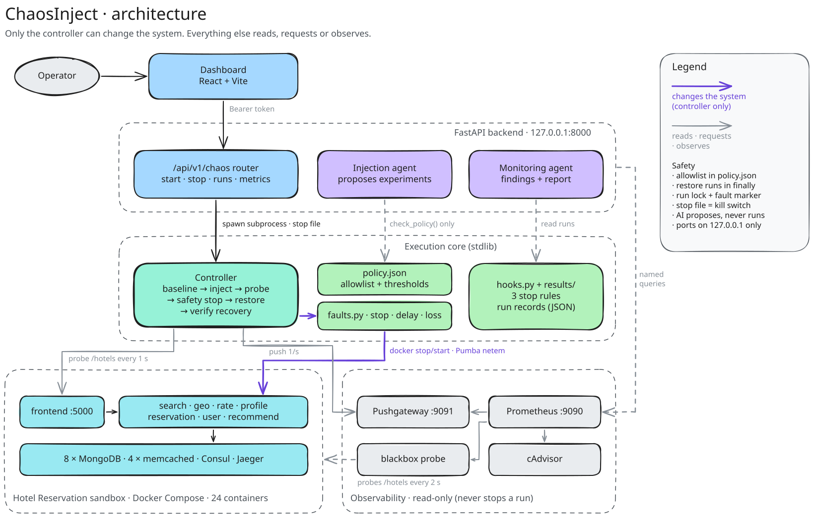
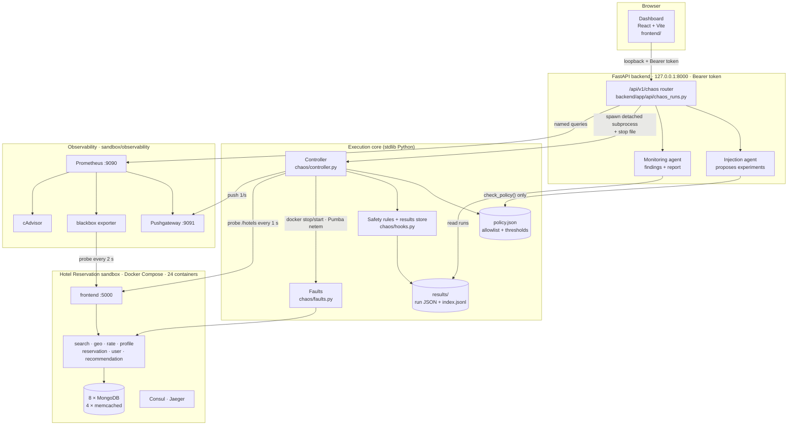
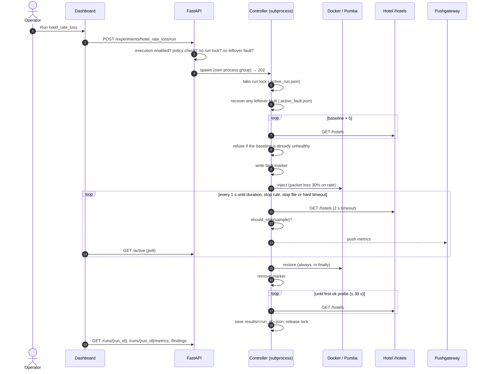

# Architecture

ChaosInject injects one bounded fault into a real microservice app, measures the impact, stops automatically when a safety rule trips, restores the fault, and verifies recovery. AI agents then propose the next experiments and explain the weaknesses.

**The core rule: only the controller can change the system.** The API, the UI, the AI agents and Prometheus can read results, request a run or request a stop. None of them can call Docker or relax a safety limit.

To edit the diagram, open [`img/architecture.excalidraw`](img/architecture.excalidraw) at [excalidraw.com](https://excalidraw.com) (Open, then pick the file). After editing, export SVG and PNG with "Embed scene" off into `docs/img/`. There's also a PNG for slides: [`img/architecture.png`](img/architecture.png).

## Components

The same picture as a Mermaid diagram, which is easier to edit in a text editor:

| Component | Where | Does | Can change the system? |
|---|---|---|---|
| Hotel sandbox | `sandbox/hotel/` | DeathStarBench Hotel Reservation: 10 Go gRPC services, 8 MongoDB, 4 memcached, Consul, Jaeger. Images are pinned by digest, and `restart: no` keeps failures visible | (the target) |
| Dependency map | `docs/dependency-map.json` | 24 nodes, 41 edges, the call order for each endpoint, and broken edges marked | No |
| **Controller** | `chaos/controller.py` | Runs the policy check, takes a baseline, injects the fault, probes every second, stops on a safety rule, restores the fault, verifies recovery and saves the run | **Yes, and it's the only component that can** |
| Faults | `chaos/faults.py` | `container_stop` (Docker CLI), `network_delay` and `packet_loss` (Pumba netem, checking that netem is active after inject and gone after restore) | Only through the controller |
| Safety rules + results | `chaos/hooks.py`, `chaos/policy.json` | Three stop rules (5 consecutive failures, error rate over 50%, a p95 latency limit). Refuses to inject if the baseline is already unhealthy. Saves every run | No |
| API | `backend/app/api/chaos_runs.py` | Lists experiments, starts the controller as a detached subprocess, reports the active run, writes the stop file, serves runs, findings, proposals and run metrics | It can start a controller, and only when `CHAOS_EXECUTION_ENABLED=true` |
| Injection agent | `backend/app/intelligence/injection_agent.py` | Ranks experiment proposals from the dependency map and run history. Each proposal passes `check_policy`. It's read-only, and a human starts the run | No |
| Monitoring agent | `backend/app/intelligence/monitoring_agent.py` | Ranks weaknesses by severity, citing `run_id`s and suggesting fixes. Produces a Markdown/HTML report | No |
| Dashboard | `frontend/` (served from `frontend/dist`) | Experiments, live run with Stop, runs table, run detail chart, findings, proposals | It can request a run or a stop through the API |
| Observability | `sandbox/observability/` | Pushgateway (controller metrics), blackbox (independent probe), cAdvisor (per-container stats), Prometheus (2-day retention) | No. It's observability only |

## One experiment, end to end

## Safety design

- **Allowlist.** `policy.json` lists the allowed targets and fault types, and sets `max_duration_s` 60, `hard_timeout_s` 120 and `recovery_timeout_s` 30. Experiments and agents can't change it.
- **Stop rules,** checked after every probe:
  - 5 consecutive failures
  - error rate over 50% across the last 10 probes
  - p95 latency above min(2000 ms, max(5× baseline p95, 200 ms)), with at least 3 slow probes
  - If the check itself errors, the run stops.
- **Restore first.** Restore runs in a `finally` block before anything else. Network faults check that netem is actually gone, and raise `CleanupError` if not.
- **Crash recovery.** A marker file exists while a fault is injected. If the controller is killed mid-fault, the next run (or `--recover`, or `POST /recover`) restores the fault first.
- **One run at a time.** The run lock holds the controller's pid. A lock left by a dead process is taken over, and pid liveness is checked with the Windows API on Windows.
- **Kill switch.** Ctrl+C, or `POST /active/stop`. The stop writes `results/.stop_request`, which the controller checks before injecting and on every probe.
- **API isolation.** The controller runs in its own process group, so an API crash or restart doesn't interrupt a restore. I tested this by hard-killing the API mid-fault. Run state comes from the lock file, so it survives an API restart.
- **Non-blocking API.** The agent routes run in worker threads, so a slow model call can't stall `/active` or Stop.
- **AI is advisory only.** The agents output proposals and findings. Intelligence code doesn't import `subprocess` or call Docker, and a unit test checks this. Model rewording is optional: it uses env-configured keys, every number it produces must come from the facts, and it falls back to deterministic text.
- **Local only.** Every port binds to 127.0.0.1, and the API needs a Bearer token.

## Data contracts

- **Run record:** [`contracts/run.schema.json`](../contracts/run.schema.json), validated in tests with `jsonschema`.
- **API types:** `contracts/v1/openapi.json` generates `frontend/src/generated.ts`. CI rejects drift between them.
- **Run metrics:** described in [observability.md](observability.md#api-metrics-for-a-saved-run).

## Where it runs

- **Fully verified:** Windows 11 / amd64 with Docker Desktop. That covers all faults, the API kill test and the observability stack.
- **Apple Silicon:** the hotel app runs on M2 and M5 under amd64 emulation. Network faults (delay, loss) aren't observable through Docker Desktop for Mac's port forwarding, so demo them on amd64.
